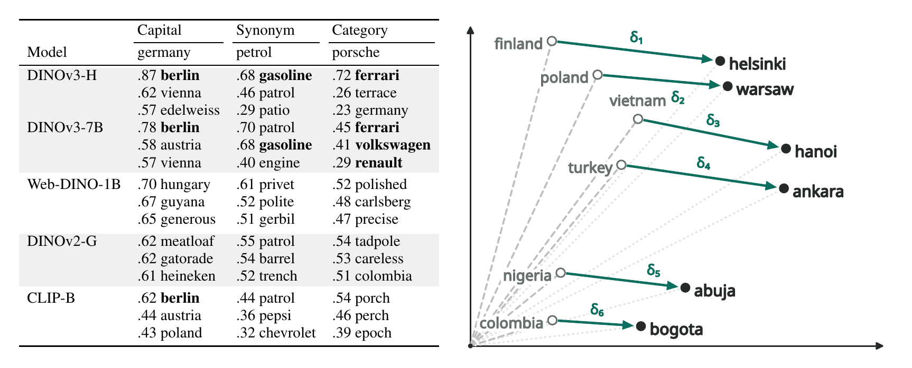
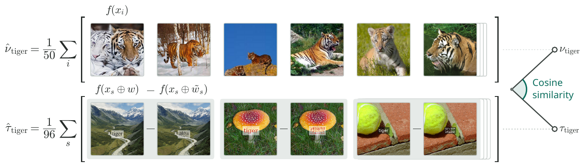

# Vision Transformers Learn Word Meaning from Images Alone

**Technical University of Denmark**

Anders Gjølbye\*, Sebastian Ray Mason\*, Stella Frank, Lars Kai Hansen (\*equal contribution)

DINOv3 is trained on images alone, without captions, class labels or any other
language supervision. We render words on images, embed the images with
fourteen vision transformers and find that the two largest DINOv3 models still
place related words close together. This repository holds the code and word
lists behind the paper.

<p align="center">
  
</p>

Left: the nearest words in five models, with cosine similarities. Bold marks a
capital, a synonym or a brand from the same industry. Right: six hand-picked
country-capital pairs in DINOv3-H.

## Main results

- In DINOv3-H and DINOv3-7B, 60% of countries have their capital among their
  ten nearest words, against 55% in CLIP-B, which learned from image-caption
  pairs. Nouns and brands group by category about as often as in CLIP-B.
- Synonyms are harder. A word's synonym is among its ten nearest words for 6%
  of words in DINOv3-H and 10% in DINOv3-7B, against 20% in CLIP-B and 69% to
  74% in text encoders. For *petrol*, DINOv3-H ranks *gasoline* first, while
  ten of the other thirteen models rank the look-alike *patrol* first.
- DINOv3-L shows a weaker version of the same structure. The eight other
  self-supervised models, DINOv3-B, Web-DINO-1B and the DINOv2 and MAE models,
  do no better on these measures than an untrained ViT-B.
- In DINOv3-H, a rendered ImageNet class name ranks its own class first among
  all 1,000 classes for over half of the 200 names tested.
- Finetuning on COCO images with written or spoken captions raises synonym
  retrieval and category grouping in DINOv3-H, lowers its capital retrieval and
  changes the other finetuned models little.

The numbers are from the paper.
[Reproducing the paper](#reproducing-the-paper) lists the notebook behind each
figure and table.

## How it works

<p align="center">
  
</p>

Top: the visual direction of the class *tiger*. Bottom: the word direction of
its name, from word images and their scrambled controls.

Each word is rendered on 96 background images. Every word image has a control
image with the same background, typography and ink color, in which the letters
are phase-scrambled so that nothing is readable. The difference between the two
embeddings, averaged over the backgrounds and centered over the vocabulary, is
the word direction. Two words are compared by the cosine similarity of their
word directions, and partner retrieval asks whether a word's synonym or capital
is among its ten nearest words, out of 1,560. A class's visual direction is the
centered mean embedding of its ImageNet-1k validation images, and comparing it
with the word direction of the class name tests whether a name points to the
images it names.

## Models

| Training | Models |
|---|---|
| Images only, self-supervised | DINOv3-B, -L, -H and -7B, Web-DINO-1B, DINOv2-B, -L and -G, MAE-B, -L and -H |
| Image-caption pairs | CLIP-B, SigLIP2-B |
| None, a baseline for visual form | Untrained ViT-B |

For comparison, three Qwen3 text encoders embed the same words as text, and the
w2v-BERT 2.0 speech encoder embeds them as synthesized speech.

## Installation

```bash
git clone https://github.com/gjoelbye/vision-word-semantics.git
cd vision-word-semantics
conda env create -f environment.yml
conda activate vit-semantic
python -m nltk.downloader wordnet omw-1.4
```

A full run also needs:

- a GPU with 32 GB of memory and about 750 GB of free disk
- [espeak-ng](https://github.com/espeak-ng/espeak-ng), which turns the words
  into phonemes for the speech synthesizer
- the fonts PT Sans, Nimbus Roman and URW Gothic for rendering, and Noto Sans
  for the figures
- a Hugging Face account with access to the gated DINOv3 models and
  ImageNet-1k, signed in through the Hugging Face CLI

The repository holds no datasets, caches or trained weights. Model weights
download on first use.

## Data

The ImageNet-1k validation images and SPEECH-COCO, which holds the COCO images
with written and spoken captions, take about 166 GB together.
[data/README.md](data/README.md) gives the download commands and lists what
each stage writes under `data/`. To keep the data somewhere else, set
`VIT_SEMANTIC_DATA`.

## Reproducing the paper

The four stages run in order, each reading what the one before wrote.

| Stage | Command | Hardware | Time |
|---|---|---|---|
| Render the word images and controls | `bash scripts/run_stimuli.sh` | CPU | a few hours |
| Embed them with every model and encoder | `bash scripts/run_features.sh` | GPU | 1-2 days |
| Finetune ten models on SPEECH-COCO, with written and with spoken captions | `bash scripts/run_finetune.sh` | GPU | 2-3 days |
| Compute the results, figures and tables | `bash scripts/run_analysis.sh` | CPU | about an hour |

Each `run_*.sh` script lists its inputs at the top and says which steps resume
after an interruption. The analysis stage writes result tables to `results/`,
then runs the notebooks, which write figures to `figures/` and LaTeX tables to
`tables/`. All three folders are committed.

### Notebooks

| Notebook | Paper |
|---|---|
| `figure1_neighbours` | Figure 1 |
| `figure2_datasets` | Figure 2 |
| `figure3_language_alignment` | Figure 3 |
| `figure4_rendering` | Figure 4 |
| `figure5_composition` | Figure 5, Tables 11 and 12 |
| `figure6_finetune` | Figure 6, Table 15 |
| `table1_models` | Tables 1 and 4 to 7 |
| `table2_concepts` | Tables 2 and 8 to 10 |
| `table3_wordlists` | Table 3 |
| `table13_feature_models` | Tables 13 and 14 |

### Notes on exact reproduction

- The recorded run used espeak-ng 1.51, PT Sans 2014-11-21, URW base35
  2020-09-10 and Noto Sans 2024-04-01 (`NotoSans[wght].ttf`).
- `environment.yml` pins the direct Python dependencies.
  `pip install -e ".[dev]"` in a Python 3.13 environment installs the same
  packages without pins.
- Pretrained models load their default Hugging Face revision.
- Run the stimulus stage once per data directory. A second run can choose
  different backgrounds, and later stages do not detect the change.
- Training on other hardware or library versions can keep the checkpoint from
  a different step. Before embedding a retrained model, set its step in
  `_FINETUNES` in [src/models.py](src/models.py). A smaller GPU needs a smaller
  micro-batch, set in [src/finetune/training.py](src/finetune/training.py), which
  can also change the step kept.

## Repository layout

| Directory | Contents |
|---|---|
| `lexicon/` | Eight word lists with 1,481 words and names plus 80 pseudowords, 200 ImageNet class names, and the two-clue items, pairs of words that together point to a third |
| `src/` | Rendering, model loading, measurements and statistics |
| `scripts/` | The four stages, one folder each, with a `run_*.sh` script per stage |
| `notebooks/` | One notebook per figure or table group of the paper |
| `results/` | The result tables the notebooks read; see [results/README.md](results/README.md) |
| `figures/`, `tables/` | The paper's generated figures and LaTeX tables |
| `data/` | Downloads and caches, not tracked; see [data/README.md](data/README.md) |

## Citation

```bibtex
@misc{gjolbye2026vision,
  title  = {Vision Transformers Learn Word Meaning from Images Alone},
  author = {Gj{\o}lbye, Anders and Mason, Sebastian Ray and Frank, Stella and Hansen, Lars Kai},
  year   = {2026}
}
```

## License

The code and word lists are released under the [MIT License](LICENSE). The
class-name and two-clue files quote glosses from
[WordNet 3.0](https://wordnet.princeton.edu/license-and-commercial-use),
copyright Princeton University, under its license. The datasets and models
keep their own terms.
